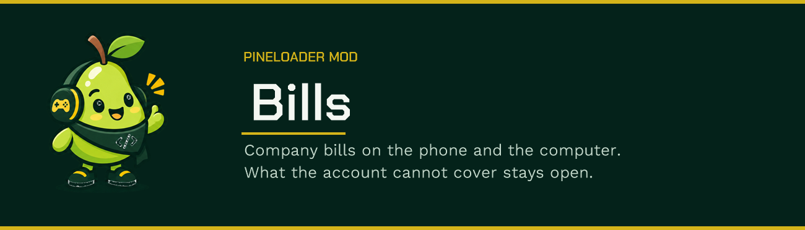
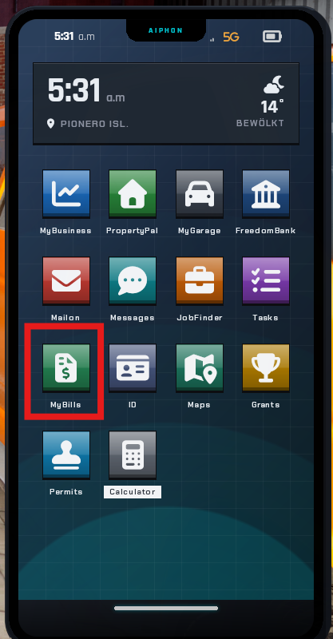
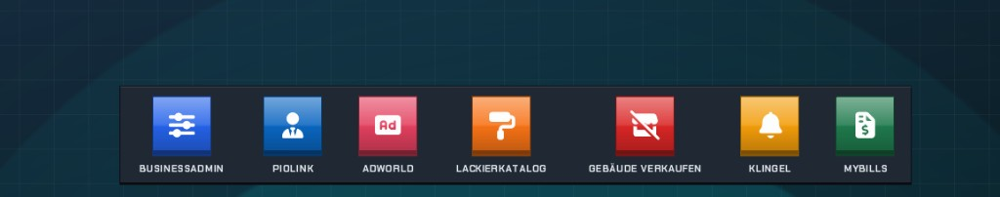
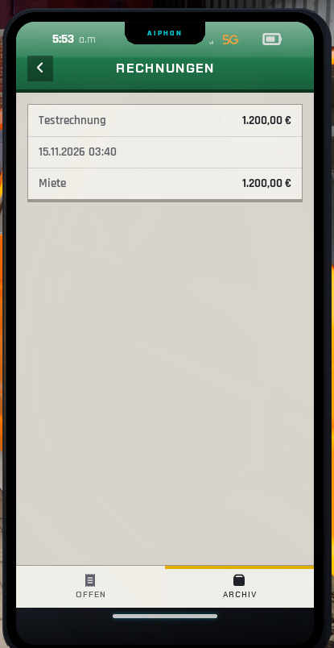
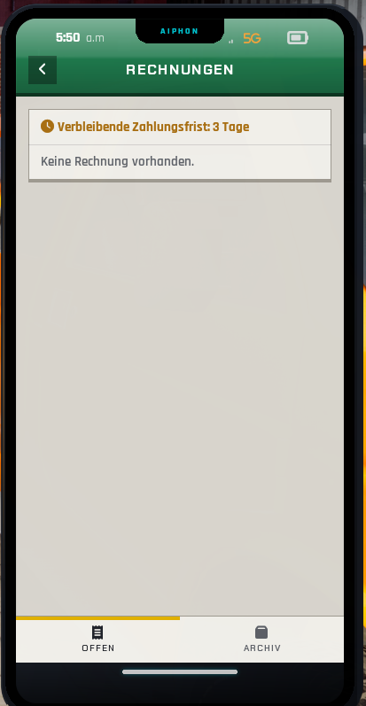
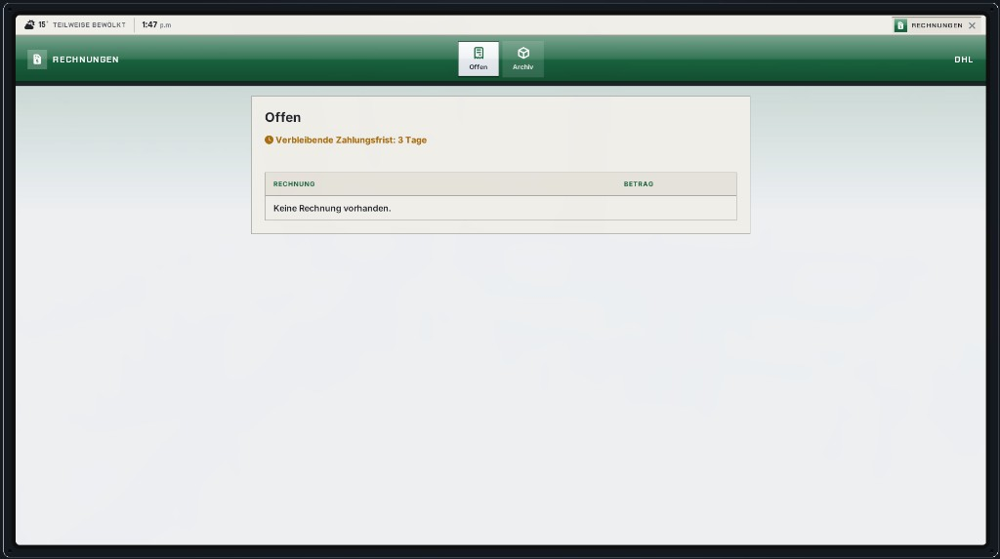
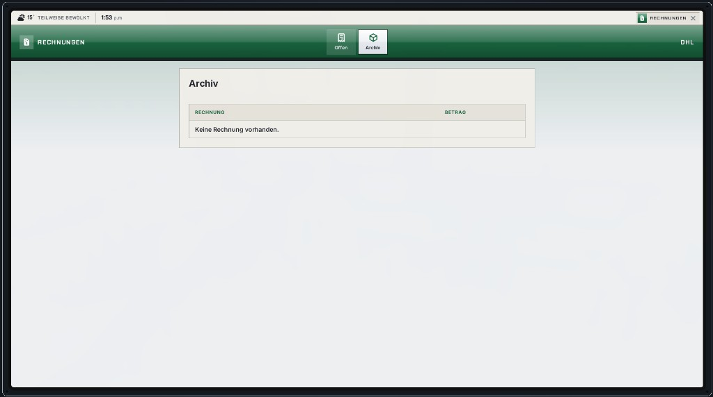

<p align="center">
  
</p>

<p align="center">
  <a href="https://github.com/EuroCent82/Bills">GitHub</a>
  &nbsp;·&nbsp;
  <a href="#mybills">MyBills</a>
  &nbsp;·&nbsp;
  <a href="#open">Open</a>
  &nbsp;·&nbsp;
  <a href="#archive">Archive</a>
  &nbsp;·&nbsp;
  <a href="#autopay">AutoPay</a>
  &nbsp;·&nbsp;
  <a href="#install">Install</a>
  &nbsp;·&nbsp;
  <a href="#author">Author</a>
</p>

<p align="center">
  A PineLoader mod for Pionero Capital.<br>
  MyBills lists the company bills on the phone and on the company computer.<br>
  A bill is paid from the company account. What the account cannot cover stays open.
</p>

<p align="center">
  <a href="https://github.com/EuroCent82/Bills"></a>
  <a href="LICENSE"></a>
  <a href="https://github.com/EuroCent82/PineLoader/releases/latest"></a>
  
</p>

<p align="center">
  <a href="https://github.com/EuroCent82/Bills/releases/latest"></a>
</p>

The loader is [PineLoader 1.0.3](https://github.com/EuroCent82/PineLoader/releases/latest). The same guide is on [PineLoader.dev](https://pineloader.dev). The pictures below are the German game. The labels follow the language of the game. On the phone, the app is named MyBills. Inside the app, the title follows the language selected in the game.

## MyBills

The phone shows MyBills with the other apps.

<p align="center">
  
</p>

On the company computer, MyBills opens as its own full-screen page, with the tabs at the top.

<p align="center">
  
</p>

Open is the tab that is showing when the app starts.

## Open

Open lists the company bills that are still unpaid. Choosing a row pays that bill from the company account. If the account cannot cover it, the bill stays open.

<p align="center">
  
</p>

<p align="center">
  
</p>

<p align="center">
  
</p>

## Archive

Archive is off until `Config\Bills.ini` says `Archive=true`. The second tab is then there, under the first. It lists bills this mod has paid. A payment made somewhere else is not added to that list.

<p align="center">
  
</p>

The remembered bills are in `PineLoader\Mods\Bills\bills.json`. Leave that file in place if you want to keep them.

## AutoPay

AutoPay is experimental and off. The row in the mod list says so. When it is on, a due bill can be paid from the company account. What the account cannot cover stays open.

```ini
[Mod]
Enabled=true
AutoPay=false
Archive=false
```

`Enabled=false` turns MyBills off. The remembered file stays where it is.

## Install

Install PineLoader first, then Bills. The same steps are in [instructions.txt](instructions.txt).

### PineLoader

1. Download [PineLoader 1.0.3](https://github.com/EuroCent82/PineLoader/releases/latest). The file is `PineLoader-1.0.3-win-x64.zip`.
2. Unpack it into a folder named `PineLoader` next to the game, so the program is `Pionero Capital\PineLoader\PineLoader.exe`.
3. Close the game and start `PineLoader.exe` once. The loader saves the official file as `PioneroCapital-Win64-Game.exe` and points `PioneroCapital-Win64-Shipping.exe` at itself.
4. Leave the Steam launch options empty. **Play** in Steam starts PineLoader first.

### Bills

1. Download [Bills 1.0.0](https://github.com/EuroCent82/Bills/releases/latest). The file is `Bills-1.0.0.zip`.
2. Copy the `Bills` folder from that zip into `PineLoader\Mods`. The two files are `Bills.dll` and `bills-agent.jar`.
3. Start the game through PineLoader. The loader writes `Config\Bills.ini` when that file is missing.

## Author

EuroCent82. The site is [PineLoader.dev](https://pineloader.dev). PineLoader is [release 1.0.3](https://github.com/EuroCent82/PineLoader/releases/latest).

## License

Apache License 2.0. The full text is in [LICENSE](LICENSE).
